<div align="center">

# 喵班 · 班级事务管理系统

**面向班长和班委的名单核对、资料收集、请假登记、通知素材、待办和奖学金事务工作台**

桌面 Web（本仓库）+ 移动端 H5 / Android APP（[配套仓库](https://github.com/Captainlidong/Class_Management_System_Mobile)），三端同一后端、会话互通

[功能总览](#-功能总览) · [界面预览](#-界面预览) · [快速开始](#-快速开始) · [架构设计](docs/ARCHITECTURE.md) · [API 文档](docs/API.md) · [贡献指南](CONTRIBUTING.md) · [更新日志](CHANGELOG.md)

    

</div>

---

## ✨ 项目简介

从一个「粘贴名单秒级比对」的小工具，长成了班长的一天里**真正会反复打开的班级事务工作台**：

- **名单筛查**是招牌能力：把第三方导出的报名/抽签/签到名单粘贴进来（或丢一张截图走 OCR），秒级输出已参与/未参与/无效/重复，一键复制未交名单、导出 Excel
- **资料收集与分发**把"收材料/发材料"做成任务：全班名单自动建档，逐行备注、批量标记、环形图进度、按列导出
- 请假、奖学金、群发素材、待办（优先级/分类/重复规则）各占一个模块，**工作台**把每天要盯的五件事汇成一屏
- 桌面端奶油底 × 深林绿治愈系主题，与移动端同一套设计令牌；全站 30+ 自绘线性 SVG 图标
- 登录保护（验证码 + IP 锁定 + 会话落库）、数据备份导出/恢复、70 项后端集成测试

## 🐱 功能总览

| 模块 | 能力 |
|---|---|
| 🏠 工作台 | 待办逾期/今日、收集进度、请假中、最近筛查、班级人数五卡汇总 + 快捷操作 |
| ✨ 名单筛查 | 粘贴文本 / txt·csv 直读 / xlsx 解析 / 截图 OCR；已参与·未参与·无效·重复分栏；复制未交名单、导出、存历史 |
| 📥 资料收集与分发 | 收集/分发双口径；逐行备注、按文本批量标记、一键全部标记、批量移除、自定义列导出、进度环形图 |
| 📝 请假记录 | 登记/编辑/销假/重开、类型与状态筛选、月度统计、导出 |
| ⏰ 待办事务 | 截止时间、优先级、分类、重复规则（完成后自动生成下期）、逾期/今日提醒 |
| 🏅 奖学金统计 | Excel 导入解析、批次管理、等级分布图、收表跟踪、一键转为收集任务 |
| 📢 群发素材 | 文案多版本、附件管理、标记已发送 |
| 👥 基础资料 | 基准名单（批量导入/锁定）、筛查历史、长期任务、自定义分组 |
| ⚙️ 系统管理 | 登录保护、全量备份导出/恢复、运行状态、会话管理 |

## 🖼 界面预览

> 以下截图取自 1440×900 桌面视口下的真实渲染（演示数据）。

| 登录 | 工作台 | 名单筛查 |
| :---: | :---: | :---: |
| 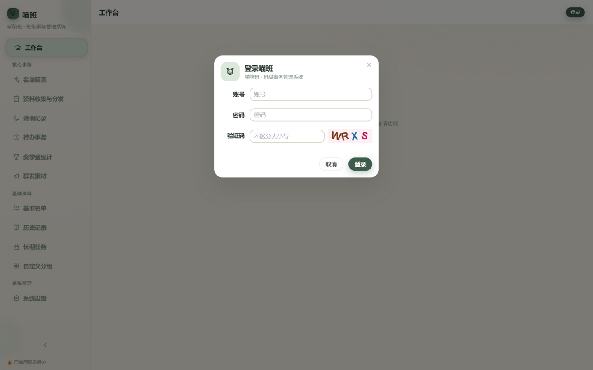 | 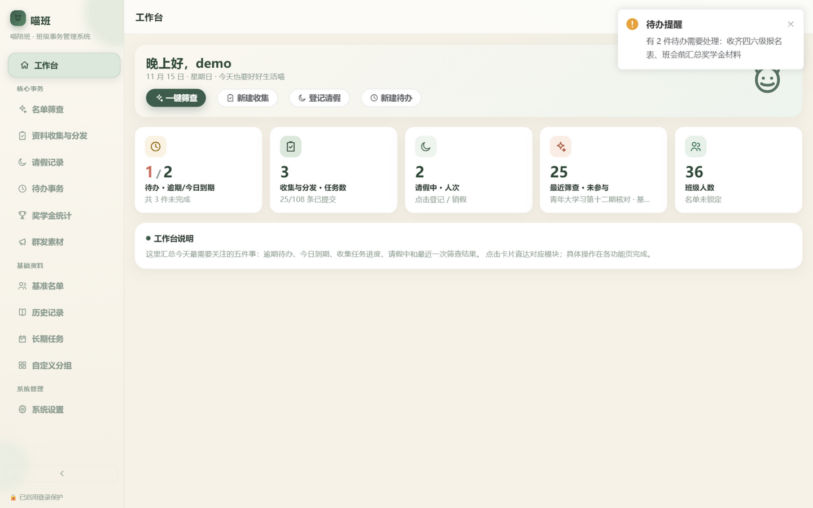 | 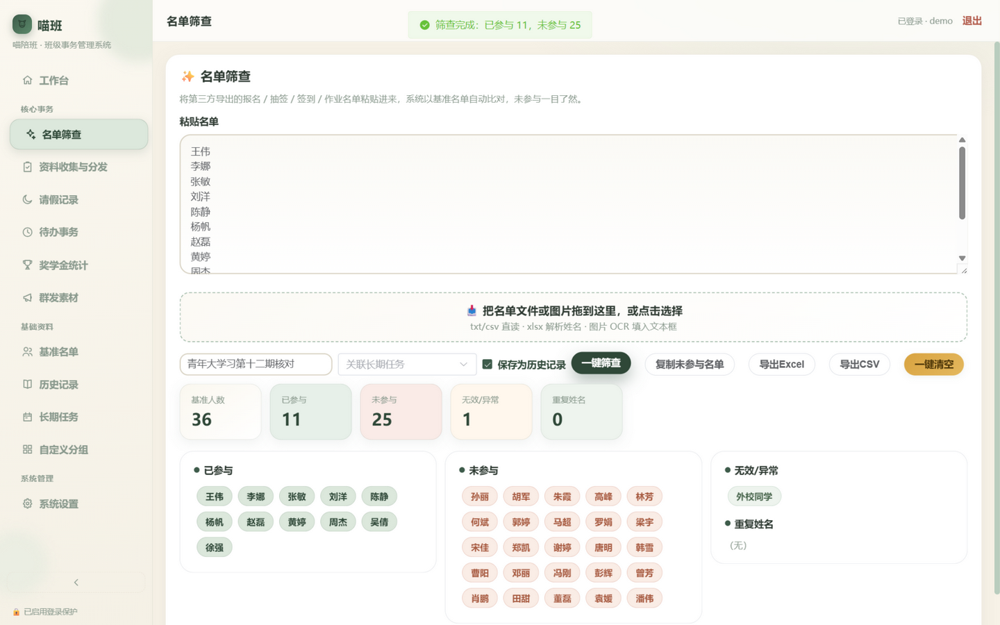 |

| 资料收集与分发 | 任务详情 | 待办事务 |
| :---: | :---: | :---: |
| 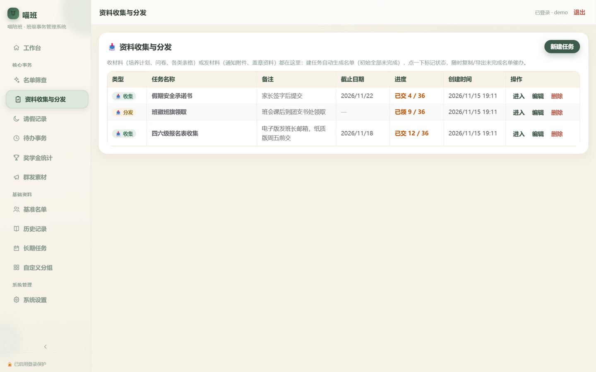 | 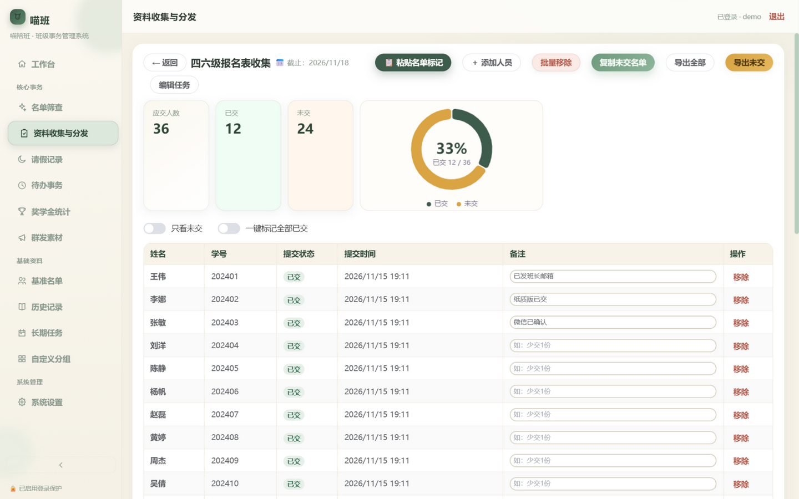 | 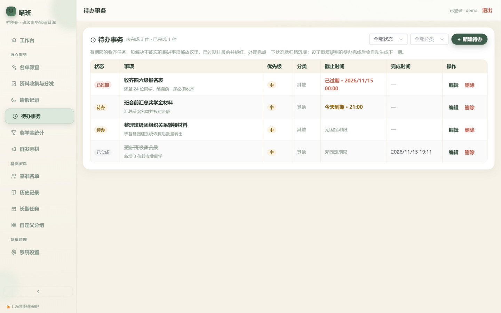 |

| 基准名单 | 请假记录 | 奖学金统计 |
| :---: | :---: | :---: |
| 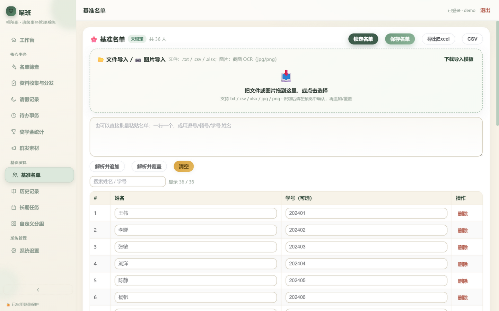 | 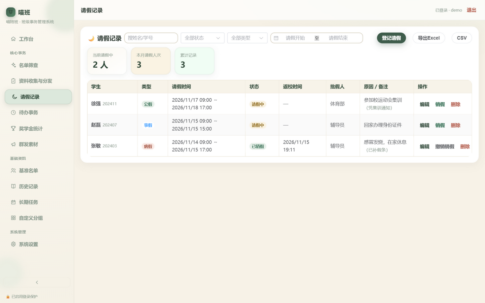 | 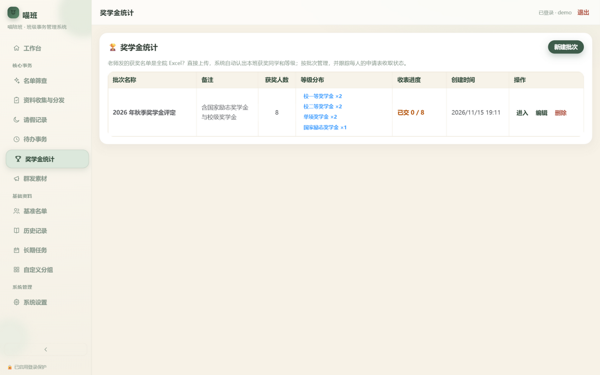 |

| 群发素材 | 系统设置 |
| :---: | :---: |
| 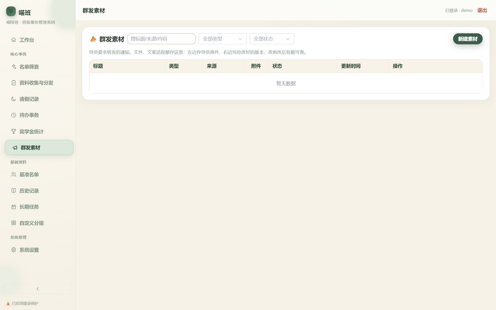 | 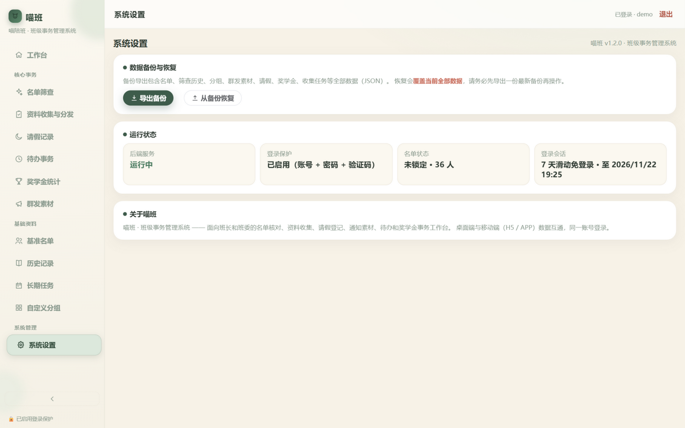 |

## 🧱 技术栈

| 层 | 选型 |
|---|---|
| 后端 | Spring Boot 3.2 · Java 19 · Spring Data JPA · MySQL 8 |
| 前端 | Vue 3.4 · Element Plus 2.7 · ECharts 6（按需引入）· Pinia · Vite 5 |
| OCR | Windows 系统 OCR 优先，Tesseract（chi_sim）回退 |
| 测试 | Spring Boot Test + H2 内存库集成测试 × 70 |
| 部署 | 前端产物打包进 Spring Boot jar，单文件部署 |

## 🚀 快速开始

### 环境要求

- JDK 19+、Maven 3.6+、Node.js ≥ 18、MySQL 8

### 1. 数据库

创建 MySQL 库 `class_mgmt`，连接配置在 `backend/src/main/resources/application.yml`（本机专属覆盖可建 `application-local.yml`，不入库）。

### 2. 启动后端

```bash
cd backend
mvn spring-boot:run          # 或 IDEA 直接运行 ClassMemberApplication
```

`http://127.0.0.1:8080`。首次启动名单为空时自动写入 36 名示例学生（`app.seed-sample=false` 可关闭）。

### 3. 启动前端

```bash
cd frontend
npm install
npm run dev                  # http://127.0.0.1:5173，/api 已代理到 8080
```

### 4. 运行测试

```bash
cd backend
mvn test                     # 70 项集成测试（H2 内存库，无需 MySQL）
```

### 5. 打包部署

```bash
# 前端产物同步进后端
cd frontend && npm run build
rm -rf ../backend/src/main/resources/static/* && cp -r dist/* ../backend/src/main/resources/static/

# 打包（clean 必须加，避免残留旧前端产物）
cd ../backend && mvn clean package
java -jar target/class-member-backend-1.0.0.jar
```

生产环境建议：Nginx 反代 8080 + 配置 `app.access-username` / `app.access-password` 启用登录保护。详细运维指引见移动端仓库 README 的部署章节。

## 📁 目录结构

```
├── backend/                         # Spring Boot 后端
│   └── src/main/java/com/classmgmt/
│       ├── web/                     # 13 个控制器 + 全局异常 + 认证过滤器
│       ├── service/                 # 业务服务（筛查/收集/请假/奖学金/OCR/导出/认证/工作台聚合）
│       ├── domain/                  # 15 个 JPA 实体
│       └── repo/                    # Spring Data 仓库
├── frontend/
│   └── src/
│       ├── views/                   # 12 个页面（工作台/筛查/收集/请假/待办/奖学金/素材/名单/历史/任务/分组/设置）
│       ├── components/              # DesktopIcon 线性图标库、DonutChart 环形图
│       ├── stores/                  # Pinia（认证态、筛查草稿）
│       └── styles.css               # 全站设计令牌（奶油 × 深林绿主题）
├── docs/
│   ├── ARCHITECTURE.md / API.md     # 架构与接口文档
│   ├── screenshots/                 # 界面截图
│   ├── compose/spec/                # Compose 特性规格
│   ├── 班级成员管理系统需求分析文档.md
│   └── 用户手册.md
└── LICENSE
```

## 🔐 安全机制

- **登录保护**：`app.access-password` 非空即启用——账号 + 密码 + 图形验证码；15 分钟内 5 次密码错误锁定来源 IP（支持 X-Forwarded-For 取真实 IP）
- **会话**：`CMS_SESSION` HttpOnly Cookie，7 天滑动过期，**落库存储**（服务重启不掉线），最多 10 个会话
- **备份**：`/api/backup/export` 全量 JSON 导出、`/api/backup/import` 覆盖式恢复（桌面端「系统设置」页可视化操作）
- 未配置口令时默认仅本机访问（开发模式）

## 🔗 配套仓库

| 端 | 仓库 |
|---|---|
| 移动端 H5 / Android APP | [Class_Management_System_Mobile](https://github.com/Captainlidong/Class_Management_System_Mobile) |

## 📄 License

[MIT](LICENSE) © 2026 Captain_Dong
